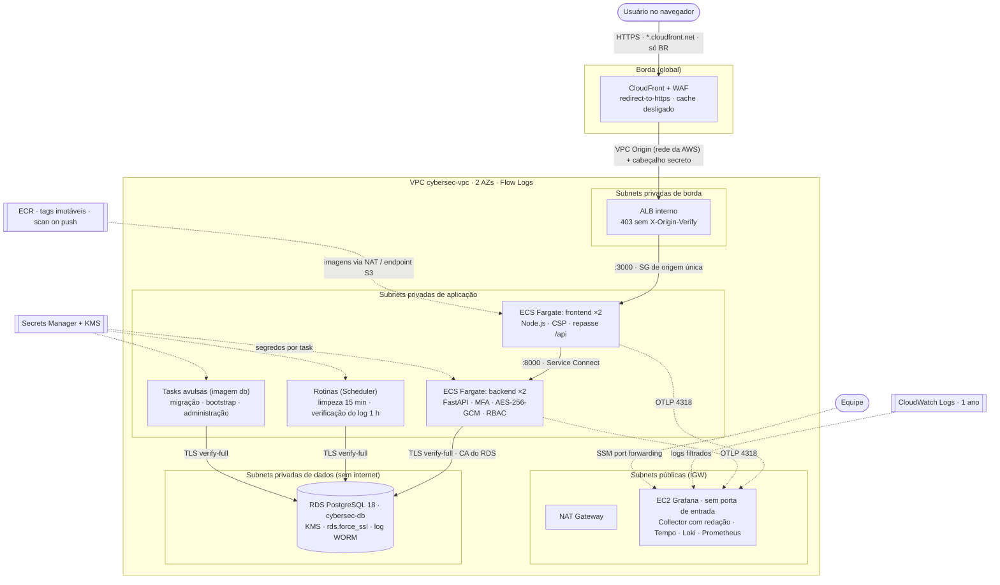
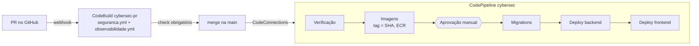

# CyberSec Saúde

Sistema de apoio à Oferta de Cuidados Integrados (OCI) da SESAU Recife. Projeto acadêmico de Segurança da Informação.

Documentação: [`docs/SPEC.md`](docs/SPEC.md), [`docs/ARCHITECTURE.md`](docs/ARCHITECTURE.md) e [`infra/README.md`](infra/README.md) (implantação na AWS). Os ADRs, o modelo de ameaças e o relatório de segurança são mantidos fora do repositório, porque descrevem riscos em aberto.

> **Ambiente acadêmico:** só dados fictícios. A região `us-east-1` e o RDS no plano gratuito não servem para dados reais de pacientes (LGPD, arts. 11 e 33).

## Arquitetura na AWS



| Camada | Componentes | Exposição |
|---|---|---|
| Borda | CloudFront (certificado padrão, WAF com regras gerenciadas e limite por IP, só Brasil) | Única entrada pública |
| Privada de borda | ALB interno, alcançado pelo CloudFront via VPC Origin | Sem IP público; SG só do prefix list do CloudFront |
| Privada de aplicação | Frontend e backend (2 a 4 tasks cada, auto scaling por CPU), rotinas do Scheduler, tasks avulsas | O ALB só alcança o frontend; só o frontend alcança o backend |
| Privada de dados | RDS PostgreSQL 18 | Só os SGs do backend, das rotinas e das tasks de banco; sem rota para a internet |
| Pública | NAT Gateway (único) e EC2 do Grafana | A EC2 não aceita entrada da internet; Grafana só por SSM |

Trechos com TLS: navegador → CloudFront e aplicação → banco (`verify-full`). Entre o CloudFront, o ALB e as tasks o tráfego é HTTP, dentro da rede da AWS e da VPC (risco aceito por não haver domínio próprio). Segredos (KEK, HMAC, senhas das roles) ficam no Secrets Manager, e cada task lê só os seus. A telemetria sai sem dado pessoal: lista de permissão de atributos no SDK e redação no Collector.

### CI/CD



Os buildspecs (`buildspecs/`) rodam ruff, mypy, bandit, pytest com gates de cobertura, pip-audit, lint e testes do frontend, `npm audit`, Playwright, gitleaks, build das imagens, `terraform test`, Checkov e o teste de redação da telemetria. Cada etapa tem uma role própria de menor privilégio, sem chave de longa duração.

## Módulos
| Pasta | Conteúdo | Na AWS |
|---|---|---|
| `frontend/` | Node.js 26 + Express + helmet; telas e repasse restrito `/api` | Serviço ECS Fargate, alvo do ALB interno |
| `backend/` | Python 3.14 + FastAPI (rotas → serviços → repositórios) | Serviço ECS Fargate (Service Connect) e rotinas do EventBridge Scheduler |
| `db/` | Migrations (Alembic), seeds (CID-10, cadastros), Postgres local | Tasks avulsas: migração, bootstrap e administração (ECS Exec) |
| `infra/` | Terraform (rede, ECS, RDS, CloudFront, WAF, observabilidade, CI/CD) e scripts de operação | Ver [`infra/README.md`](infra/README.md) |
| `buildspecs/` | Verificações, imagens e implantação | CodeBuild e CodePipeline |

Todas as imagens rodam como não-root, com sistema de arquivos somente leitura, sem capabilities e com lockfile (`uv.lock`, `package-lock.json`).

## Pré-requisitos
Docker, [uv](https://docs.astral.sh/uv/) e Node.js 26.

## Primeira configuração do banco
```bash
cp .env.example .env                      # preencha os valores (POSTGRES_USER != app_user/migrator)
cd backend && uv run python -m scripts.gerar_chaves && cd ..   # KEK, HMAC_KEY e LOG_CHECKPOINT_KEY no .env (sem exibir)
docker compose up -d db
cd backend && uv run --env-file ../.env python -m scripts.bootstrap_db   # cria roles e schema
cd .. && uv run --project backend --env-file .env alembic upgrade head   # aplica migrations
cd backend && uv run --env-file ../.env python -m scripts.importar_cid && cd ..  # catálogo de CID (ADR-0020)
cd backend && uv run --env-file ../.env python -m scripts.criar_usuario \
  --cpf 000.000.000-00 --nome "Seu Nome" --email voce@recife.pe.gov.br   # senha pedida sem eco
```

## Acesso e recuperação
- **1º acesso:** CPF + senha → cadastro do MFA (QR code no Google/Microsoft Authenticator) → guarde os 10 códigos de recuperação.
- **Novos usuários, grupos e reset de acesso:** pela tela **Usuários**, com perfil Administrador (ADR-0017). Os scripts abaixo ficam para o primeiro administrador e para emergências.
- **Esqueceu a senha ou perdeu o celular e os códigos, sem administrador disponível:** quem tem acesso ao servidor roda
  `cd backend && uv run --env-file ../.env python -m scripts.resetar_acesso --cpf ...`,
  que gera uma senha temporária (mostrada uma vez); o usuário recadastra o MFA e troca a senha.

## Perfis de acesso (RBAC)
```bash
cd backend && uv run --env-file ../.env python -m scripts.atribuir_grupo --cpf 000.000.000-00 --grupo Administrador
```
Grupos: Administrador, Gestor, Gestor do Cuidado, Navegador, Auditor (`--remover` desfaz). Sem grupo, o usuário entra mas não acessa pacientes (ADR-0011).

## Integridade do log de auditoria
```bash
cd backend && uv run --env-file ../.env python -m scripts.verificar_log --checkpoint
```
Recalcula a cadeia de hashes inteira, grava um checkpoint assinado e imprime a **âncora** (`seq:hash`): guarde-a fora do sistema e confira depois com `--ancora seq:hash`. Sai com código 1 se detectar adulteração (ADR-0010).

## Teste ponta a ponta (navegador)
```bash
cd frontend && npx playwright install chromium && sudo npx playwright install-deps chromium  # 1x
cd backend && uv run --env-file ../.env python -m tests.e2e_ambiente
```
Sobe um banco temporário, a API e o frontend em portas próprias (HTTP em `localhost`, como atrás da borda na AWS), roda o fluxo completo no Chromium (login, MFA, pacientes, logout) e remove tudo no fim (ADR-0012, ADR-0029).

## Subir o ambiente
```bash
docker compose up --build
```
Acesso em **http://localhost:3000**. Só o frontend publica porta; a API não (ADR-0029). O banco usa TLS obrigatório com um certificado efêmero gerado pelo próprio container, então não há certificado para criar, instalar ou renovar. Na AWS, o HTTPS fica no CloudFront e as rotinas rodam pelo EventBridge Scheduler.

Migrations pela imagem do módulo `db` (a mesma usada na AWS):
```bash
docker compose run --rm migrar                                  # alembic upgrade head
docker compose run --rm migrar python -m scripts.bootstrap_db   # roles (1x)
```

As rotinas periódicas rodam no container `tarefas` (limpeza a cada 15 min, verificação do log a cada hora). Acompanhe com `docker logs cybersec_saude-tarefas`.

## API e Swagger (desenvolvimento)
```bash
cd backend && uv run --env-file ../.env uvicorn app.main:create_app --factory --reload
```
Swagger em http://127.0.0.1:8000/docs (desabilitado quando `ENVIRONMENT=prod`).

## Desenvolvimento
```bash
# Backend (com --env-file os testes de integração usam um banco temporário, criado e removido)
cd backend && uv sync
uv run --env-file ../.env pytest && uv run ruff check . && uv run mypy . && uv run bandit -r app && uv run pip-audit

# Frontend
cd frontend && npm ci
npm test && npm run lint && npm audit

# Migrations (na raiz)
uv run --project backend --env-file .env alembic upgrade head
```
