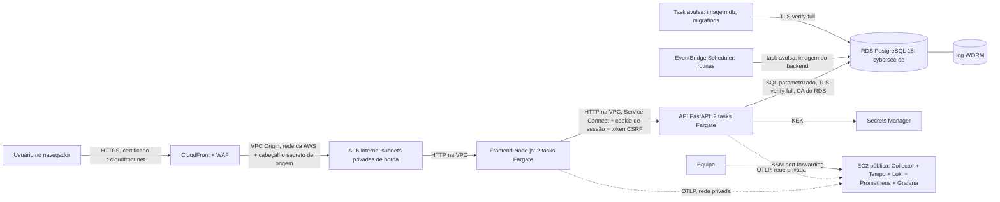
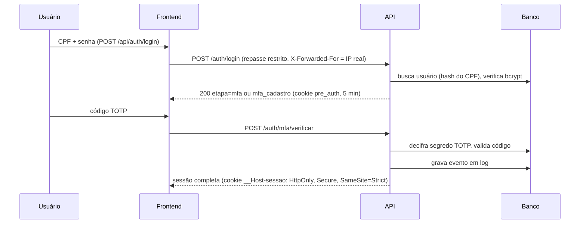

# ARCHITECTURE: CyberSec Saúde

Versão: 0.2 (23/11/2026) | Relacionado: `SPEC.md`, `THREAT_MODEL.md`, `/docs/adr`

## 1. Contexto
Sistema web de apoio à Oferta de Cuidados Integrados (OCI) da SESAU Recife: pacientes, OCIs e navegação entre etapas, agenda e vagas, catálogos (unidades, serviços, CID, tipos de OCI), gestão de usuários, dashboard e consulta do log de auditoria. Lida com dados de saúde (sensíveis pela LGPD, art. 5º, II). Prioridades: confidencialidade, integridade e rastreabilidade.

## 2. Visão geral (C4: containers)

Implantação na AWS (ADR-0029, ADR-0030, ADR-0032; desenho de referência em `Arquitetura.PNG`, que simplifica a rede: na implantação real o ALB é interno e há NAT Gateway). O README traz a versão com as camadas de subnet.



| Componente | Tecnologia | Responsabilidade |
|---|---|---|
| Borda | CloudFront (VPC Origin) + ALB interno | Único ponto exposto: TLS na entrada (certificado padrão do CloudFront), redirecionamento de HTTP, WAF, timeouts e IP real do cliente (`CloudFront-Viewer-Address`) (ADR-0029, ADR-0030) |
| Frontend | Node.js | Telas, fluxo de login/MFA, headers de segurança (CSP, HSTS, Trusted Types) e repasse restrito `/api` para a API, com checagem de origem (ADR-0012, ADR-0013) |
| Backend | Python 3.14 + FastAPI | Regras de negócio, autenticação, MFA, criptografia, auditoria, token CSRF e limite por IP |
| Tarefas | Python (mesma imagem do backend), EventBridge Scheduler | Limpeza de sessões e contadores, verificação periódica da cadeia do log (ADR-0013, ADR-0029) |
| Migrations | Imagem `db/` (Alembic) | Migrations, bootstrap das roles e importação do CID, como task avulsa (ADR-0029) |
| Banco | RDS PostgreSQL 18, instância `cybersec-db` (AWS); PostgreSQL 18 no Docker (dev) | Persistência, triggers WORM, permissões por role |
| Chaves | Secrets Manager (AWS); `.env` (dev) | Guarda a KEK que cifra as DEKs |
| Observabilidade | OpenTelemetry (OTLP/HTTP) → Collector com redação, Tempo, Loki, Prometheus e Grafana numa EC2 | Traces e métricas com lista de permissão de atributos (rota como modelo, sem URL, IP, cabeçalhos, SQL nem mensagem de exceção); 2ª barreira de redação no Collector; logs do CloudWatch filtrados para o Loki; dashboard APM e alertas de disponibilidade e p95; acesso só por SSM (ADR-0030, ADR-0031, ADR-0037) |
| CI/CD | CodeConnections + CodePipeline + CodeBuild + ECR | Check `cybersec-pr` obrigatório nos PRs do GitHub; na `main`: verificação, imagens com a tag do commit, aprovação manual, migrations e rolling update (ADR-0030, ADR-0038) |

## 3. Camadas do backend

```
rotas (routers)  ->  serviços  ->  repositórios  ->  banco
      |                 |
   validação        regras de negócio, cripto, auditoria
   (Pydantic)
```
- **Rotas:** só recebem/validam entrada e devolvem resposta. Sem lógica de negócio.
- **Serviços:** autenticação, MFA, criptografia, auditoria, regras do domínio.
- **Repositórios:** único ponto de acesso ao banco (queries parametrizadas/ORM).

Estrutura:
```
backend/app/
  api/         # routers
  core/        # config, segurança, dependências, telemetria
  services/    # auth, mfa, crypto, audit, domínio
  repositories/
  models/      # tabelas
  schemas/     # Pydantic
backend/scripts/ # rotinas e administração
backend/tests/
```

## 4. Fluxo de autenticação com MFA


Regras (ADR-0002, 0008, 0009): token temporário só vale para a etapa MFA; sessão expira com 15 min sem uso e 8 h no máximo; rate limit e bloqueio progressivo nas duas etapas; códigos de recuperação de uso único, armazenados com hash. Com a sessão completa, toda escrita exige o token CSRF, entregue por `GET /auth/sessao` (ADR-0013).

## 5. Criptografia de dados sensíveis (envelope encryption)

- **Dado sensível** é cifrado com uma **DEK** (AES-256-GCM, nonce único por registro).
- A **DEK** é cifrada com a **KEK** e guardada junto do registro (`dek_encrypted`).
- A **KEK** nunca fica no banco: vem de variável de ambiente (dev) ou secret manager (produção).
- Para buscar por campo cifrado (ex.: e-mail), usar **hash determinístico com chave (HMAC-SHA256)** em coluna separada.
- Rotação: trocar a KEK exige apenas recifrar as DEKs, não os dados (`rewrap`).
- Cada campo é cifrado com AAD (tabela, coluna, id do registro): valor movido de registro não decifra.
- Implementação: `backend/app/core/crypto.py`; detalhes e alternativas no ADR-0004.

| Dado | Proteção |
|---|---|
| Senha | bcrypt com salt, custo >= 12 (hash, não é cifrado) |
| Segredo TOTP | AES-256-GCM |
| Dados de saúde (CPF, diagnóstico, etc.) | AES-256-GCM por campo |
| Códigos de recuperação | Hash |
| Em trânsito | TLS até o CloudFront e até o banco; HTTP só na rede da AWS (VPC Origin) e dentro da VPC (ADR-0029, ADR-0030) |

## 6. Log de auditoria WORM

- Tabela `log` (schema `app`) **append-only**: triggers bloqueiam `UPDATE`, `DELETE` e `TRUNCATE`.
- Role da aplicação (`app_user`) com **apenas INSERT e SELECT** na tabela. Migrations rodam com outra role.
- **Hash encadeado** (ADR-0010): a trigger `log_encadear` calcula `hash = SHA-256(prev_hash + conteúdo)` sob lock, na ordem de `seq_cadeia`. Alterar um registro quebra todos os seguintes.
- **Verificação da cadeia:** `scripts.verificar_log` recalcula tudo em Python (sem confiar na função do banco). A rotina `verificacao-log` (EventBridge Scheduler na AWS; container `tarefas` em dev) executa a verificação a cada hora, e a tela de auditoria mostra o último resultado.
- **Consulta:** só leitura, com permissão `log:ler` (Auditor e Administrador), filtros por data, usuário e evento e leitura auditada (ADR-0015). O log guarda só hashes; para o Administrador, o CPF vem dos cadastros, decifrado na hora de responder, e o Auditor vê o hash (ADR-0016, ADR-0017).
- **Checkpoints assinados** (`log_checkpoint`, HMAC com chave fora do banco) e **âncora** impressa para guardar fora do sistema: revelam a remoção do fim do log.
- Pendente (nível avançado): exportar periodicamente para armazenamento com *object lock* (S3).
- Nenhum dado sensível dentro do log.

Esquema base:
```
log(id_log, data_hora, acao, resumo_acessado, ip_origem, request_id, geolocalizacao, cpf_usuario_hash, cpf_paciente_hash, id_oci, seq_cadeia, prev_hash, hash_assinatura_worm)
log_checkpoint(id_checkpoint, criado_em, seq_cadeia, hash_cadeia, assinatura)
```

## 7. Controle de acesso
RBAC com perfis (Administrador, Gestor, Gestor do Cuidado, Navegador e Auditor). Verificação **sempre no backend**, a cada requisição. Auditor tem somente leitura dos logs. Administrador não lê dados de saúde sem registro de auditoria.

Implementação (ADR-0011): usuário → `usuario_grupo` → `grupo_papel` → `papel_permissao` → permissão (todos ativos), checada pela dependência `exigir(permissao)` em cada rota, sem cache. Perfis iniciais: Administrador, Gestor, Gestor do Cuidado, Navegador e Auditor; atribuição pela tela **Usuários** (ADR-0017) ou por `scripts.atribuir_grupo` (evento `role_change`). Nas OCIs vale também o alcance por unidade (ADR-0025). Negativas geram `access_denied`. Pacientes são acessados por UUID opaco (`id_publico`); o CPF só trafega no corpo da busca.

## 8. Implantação
- **Módulos** (ADR-0029): `frontend/`, `backend/` e `db/`, cada um com a própria imagem. Todas usam usuário não-root, sistema de arquivos somente leitura e nenhuma capability.
- **AWS** (Terraform em `infra/`, região `us-east-1` no ambiente acadêmico, só com dados fictícios, ADR-0033; passo a passo em `infra/README.md`):
  - VPC `cybersec-vpc` em 2 AZs, com subnets públicas (NAT único e EC2 do Grafana), privadas de borda (ALB interno), privadas de aplicação (tasks) e privadas de dados (RDS, sem rota para a internet);
  - o CloudFront termina o TLS com o certificado padrão e alcança o ALB interno por VPC Origin, sem domínio próprio nem ACM;
  - frontend e backend são serviços ECS Fargate com 2 tasks cada (auto scaling): o ALB só alcança o frontend, e só o frontend alcança o backend (security groups);
  - RDS PostgreSQL 18 (`cybersec-db`) com `rds.force_ssl=1`, acessado com `verify-full` e a CA do RDS embutida nas imagens;
  - rotinas pelo EventBridge Scheduler (uma task definition por rotina) e migrations e bootstrap como tasks avulsas;
  - scripts administrativos (criar o primeiro administrador etc.) numa task `administracao` aberta sob demanda por ECS Exec, sem gravação do conteúdo da sessão;
  - cada task com execution role própria, que lê só os próprios segredos; senhas do banco geradas sem passar pelo state (ADR-0032);
  - Grafana em EC2 pública sem portas abertas para a internet, acessada por SSM, com IMDSv2 (hop limit 1), EBS cifrado e imagens fixadas por digest (ADR-0037);
  - pausa fora do horário de uso por `infra/scripts/ambiente.sh` (ADR-0036); RDS `db.t4g.micro` com backup de 1 dia no plano gratuito (ADR-0034).

  Requisitos de infraestrutura e variáveis por task: ADR-0029, atualizado pelos ADR-0030 e ADR-0032.
- **CI/CD** (`CICD.PNG`, ADR-0038): PR no GitHub com check do CodeBuild (`cybersec-pr`); merge na `main` dispara o CodePipeline: verificação (segurança e observabilidade), imagens no ECR, aprovação manual por e-mail, migrations, deploy do backend e do frontend. Cada etapa com role própria; o GitHub Actions foi removido (o Dependabot continua).
- **Desenvolvimento** (`docker compose up`):
  - `db` (Postgres 18, porta 127.0.0.1:5433, TLS obrigatório com certificado efêmero gerado no container), `backend`, `tarefas` e `frontend` (`http://localhost:3000`);
  - as redes `api` e `dados` são internas: o frontend não alcança o banco;
  - migrations com `docker compose run --rm migrar`.
- **Segredos:** Secrets Manager na AWS; `.env` fora do git em dev; `.env.example` versionado sem valores.

## 9. Decisões de arquitetura (`/docs/adr`)
| ADR | Tema |
|---|---|
| 0001–0006 | FastAPI, TOTP, bcrypt, criptografia de campo com envelope, log WORM, Postgres em Docker |
| 0007 | Tooling (lockfiles, uv, Dependabot); o CI do GitHub Actions foi substituído pelo 0038 |
| 0008–0010 | Login com bloqueio, sessão, cadeia de hash do log |
| 0011–0018 | RBAC, frontend e repasse, hardening (TLS, CSRF, limite), pacientes, consulta do log, gestão de usuários |
| 0019–0027 | Catálogos, CID, unidades, serviços, tipos de OCI, OCI e navegação, agenda, dashboard |
| 0028 | Revisão de segurança (T10) |
| 0029–0030 | Módulos para a AWS; implantação com RDS, VPC Origin, NAT, Grafana em EC2 e CodePipeline |
| 0031 | Telemetria OpenTelemetry com lista de permissão |
| 0032–0034 | Terraform, região `us-east-1`, RDS no plano gratuito |
| 0035–0036 | Carga de cadastros entre bancos, pausa do ambiente |
| 0037–0038 | Pilha de observabilidade na EC2, CI/CD na AWS |

## 10. Requisitos de qualidade
- Testes automatizados em auth, cripto e auditoria.
- Análise estática: `bandit`, `ruff`, `mypy`; dependências: `pip-audit`, `npm audit`; segredos: gitleaks.
- Infraestrutura: `terraform test` (provider simulado) e Checkov; telemetria: `testar_redacao.sh`.
- Tudo isso roda no CodeBuild em cada PR e no pipeline (ADR-0038).
- Teste dinâmico com OWASP ZAP ativo e autenticado: pendente.
